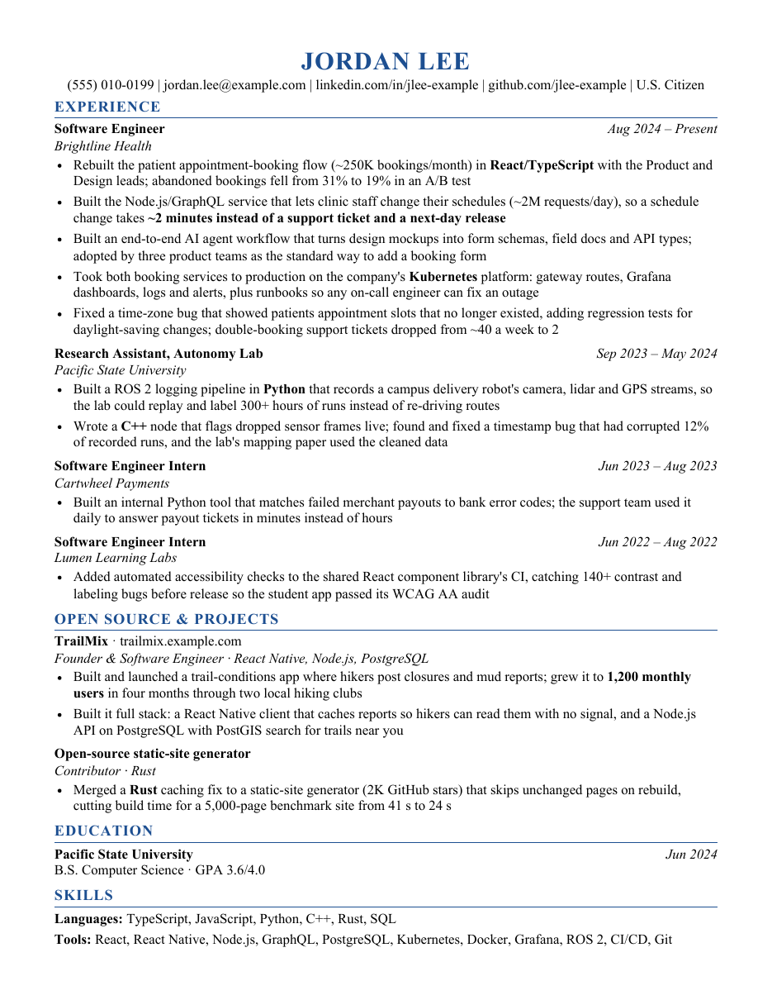

# AI resume creator and job search

Build a resume recruiters understand, find every posting you qualify for, and get more interview callbacks, using
your own Claude Code or ChatGPT/Codex subscription.

It does two things:

1. **Writes your resume with you.** The AI interviews you about your work, records every fact, then drafts a
   full one-page resume one bullet at a time, with your approval on every change. Every bullet says what you built, with
   what, and why it mattered: a recruiter can follow the opening, and an engineer respects the rest. A builder turns it
   into a PDF, refuses a page with a blank band at the bottom, and checks that screening software reads every word.
2. **Finds the jobs worth sending it to.** For any company you name (or every company in a region), it fetches every
   open posting from the employer's own hiring system, has AI screeners and reviewers read the plausible ones in full
   against your record, checks your application history, and ranks what's left by your odds and what you want. You
   get one list: what to send, in what order, with which resume. You apply yourself; nothing is ever submitted for you.



## Why it works this way

It was built for one early-career software engineer and then generalized. Their numbers
([case study](docs/CASE_STUDY.md), details anonymized):

| | Applications | Human interviews |
|---|---|---|
| Before: AI-tailored resumes per posting, applying from job boards | ~180 over ~14 months | 1 |
| After: this resume and this search | ~50 over two weeks | 5 companies interviewing |

Small samples, and several things changed at once, so read the case study's caveats. What the research does support
([evidence](docs/EVIDENCE.md)):

- **Referrals** reach an interview about 40% of the time; cold applications about 3% (Ashby, 38M applications).
- **The first week matters:** most applicants arrive then and recruiters review as they come in.
- **Per-job AI tailoring stopped paying** once AI made it free (Galdin & Silbert); hiring managers distrust
  AI-sounding applications. A few hand-polished role-family resumes beat a hundred generated ones.
- **"75% of resumes are rejected by ATS bots" is a myth** traced to a 2012 sales pitch. Software parses and sorts;
  people skim for 7–30 seconds; the hard filters are form questions.
- **Clear writing is causal:** better-written resumes produced about 8% more hires in a randomized trial of ~480K
  job seekers.

## Quick start

**Starting from zero?** Follow the step-by-step [setup guide](docs/SETUP.md): what to install on macOS, Linux or
Windows, the AI agent, and what to have ready for the first session.

You need Python 3.10+, Google Chrome (or Chromium/Edge) and poppler (`pdftotext`; macOS `brew install poppler`,
Ubuntu `sudo apt install poppler-utils`). Clone this repository (the green Code button on GitHub gives the URL), then:

```bash
cd ai-resume-creator-and-job-search
python3 -m venv .venv && source .venv/bin/activate     # Windows: .venv\Scripts\activate
python3 -m pip install -r requirements.txt
python3 -m jobhunt init
python3 -m jobhunt doctor
```

`doctor` should end with three TODO lines: your profile, inventory and resume are still templates. The setup skill
fills them in.

Then, depending on what you have:

- **Claude Code:** open this folder and say **"set me up"**. Then: "review my resume", "I want a job at Acme",
  "every job in Los Angeles I'm a fit for", "what should I apply to?".
- **Codex** (CLI or app): open this folder; it reads [`AGENTS.md`](AGENTS.md). Say "set me up".
- **ChatGPT in the browser:** use the copy-paste prompts in [`prompts/`](prompts) for the resume half
  ([guide](docs/CHATGPT_AND_CODEX.md)).

Your files (inventory, profile, resume, application history, runs) live in `workspace/`, which git ignores.

## The workflow

| Step | You say | What happens | Skill |
|---|---|---|---|
| 1 | "set me up" | Checks your machine, asks ~10 questions (where you want to work, years limit, referrals...), fills `profile.yaml` | [setup](.claude/skills/setup/SKILL.md) |
| 2 | "use my old resumes and GitHub" | With your OK, finds old resumes, reviews, local repos and GitHub pull requests; lists them, reads what you approve, records the facts as unconfirmed | [gather-sources](.claude/skills/gather-sources/SKILL.md) |
| 2b | "interview me" | Asks, in one list, only what your sources didn't answer, plus every conflict between them; records every fact, dated, in `inventory.md` | [inventory-interview](.claude/skills/inventory-interview/SKILL.md) |
| 3 | "write my resume" | Drafts bullets one at a time from the inventory; you pick and edit; builds and checks the PDF | [resume-workshop](.claude/skills/resume-workshop/SKILL.md) |
| 4 | "review my resume" | Reads it as software, a recruiter and a hiring manager would; audits every claim; changes nothing | [resume-review](.claude/skills/resume-review/SKILL.md) |
| 5 | "I want a job at Acme" | Every Acme posting fetched, screened, read in full, ranked; history checked | [find-jobs](.claude/skills/find-jobs/SKILL.md) |
| 5b | "every job in LA I'm a fit for" | The same across ~600 companies, kept to your regions | [sweep](.claude/skills/sweep/SKILL.md) |
| 6 | "what should I apply to?" | `APPLY_LIST.md` + a checkbox page: referral roles, your region, everywhere else | [apply-list](.claude/skills/apply-list/SKILL.md) |
| 7 | "I applied to X" | Logs it; rebuilds history from email (read-only) so you never apply twice | [track-applications](.claude/skills/track-applications/SKILL.md) |
| 8 | "anything new?" | New postings at your top companies within days, eligibility decided, added to your list | [watch](.claude/skills/watch/SKILL.md) |

## The resume rules in one screen

The full set, with the reason and a before/after for each, is the [resume playbook](docs/RESUME_PLAYBOOK.md).

- **A full page.** 6–8 entries, 13–15 dense bullets, about 195 characters each, down to the bottom margin. A sparse page
  fails the build. [This example](examples/jordan-lee/Jordan_Lee_Resume.pdf) shows the target.
- **Written for the engineer who decides.** The plain "what" opens the bullet for the recruiter, and the technical
  substance stays after it. A simplified bullet is a failed bullet.
- **What + how + why.** "Added self-serve scheduling to Brightline's clinic platform through a Node.js/GraphQL service (~2M
  req/day), enabling clinic managers to change hours and visit types in ~2 minutes, replacing a next-day engineering
  release." A list of tools with no purpose fails, however many keywords it hits.
- **Model first.** Real resumes from people in your field who get callbacks, plus research for your role and level.
- **Gather, then interview.** With your OK it reads your old resumes, reviews, repos and GitHub first, then asks only
  about the gaps and conflicts. Facts are recorded in an inventory; nothing goes on the page that isn't there.
- **Your real scope, both ways.** "Added X through a service", not "built the platform", when you built one layer. And
  never one page when the work was platform-wide.
- **The hardest work gets a bullet,** with the failure named.
- **Best result where the eye lands,** with its contrast right next to it.
- **Never drop a number without asking what it measures; never upgrade a status** (projected, A/B tested, merged).
- **No private names, team sizes or filler.** Public technical terms stay, even ones a recruiter won't know.
- **About two lines a bullet; one bold, two for two results;** one page, one column.
- **No city in the header; no summary; two skills lines** of things you can be questioned on.
- **One resume per role family,** chosen by reading the role. Never one per job.
- **Every build is checked:** one full page, text extracts word for word, no odd Unicode, no stranded words.

## The search rules in one screen

The full model and the evidence behind each weight: [JOB_SEARCH.md](docs/JOB_SEARCH.md).

- Postings come from the employer's own system, never a job board (boards miss postings and show the wrong dates).
- Code removes only clear mismatches, each with a quoted reason; AI screeners keep anything uncertain; reviewers read
  every remaining posting in full. Nothing is dropped silently.
- **Meeting the minimum list is not a fit:** the score is multiplied by how much of the job's daily work you've
  already done.
- **A missing years line is not eligibility;** a "Senior" title is checked against the company's own ladder.
- The application form is the real filter: required questions are checked before you spend a referral.
- Ranking: fit × experience × clearance × your locations × posting age × competition × role preference × career
  value; referrals switch off posting age. Every weight is in your `profile.yaml`.

## Commands

```bash
python3 -m jobhunt init | doctor
python3 -m jobhunt find "Acme"                     # then screen-apply <run>, then rank <run>
python3 -m jobhunt sweep --regions home,remote_us
python3 -m jobhunt screen-apply workspace/runs/<run>
python3 -m jobhunt rank workspace/runs/<run>
python3 -m jobhunt list                            # APPLY_LIST.md + apply_list.html
python3 -m jobhunt resume --all                    # build every resume variant with all checks
python3 -m jobhunt resume --check                  # report fit and lines of room; writes no file
python3 -m jobhunt keywords --companies "A,B,C"    # what postings ask for vs what your page shows
python3 -m jobhunt watch | fresh list --days 8 | fresh show "Acme" <id>
python3 -m jobhunt applied add|list|stats|import-email
python3 -m jobhunt resolve "Acme" | detect <careers-url> | register --name ... --ats ... --token ...
python3 -m jobhunt gather | gather text <file>   # with your consent: find old resumes, repos, GitHub activity
python3 -m jobhunt privacy-check
python3 -m pytest tests -q
```

## Docs

- [Resume playbook](docs/RESUME_PLAYBOOK.md): every rule, why, and examples
- [Case study](docs/CASE_STUDY.md): three versions of one resume and what happened
- [Job search](docs/JOB_SEARCH.md): the pipeline, eligibility rules and ranking model
- [Applying](docs/APPLYING.md): order, timing, referrals, forms
- [Working with the AI](docs/WORKING_WITH_AI.md): the rules the agent follows, and why
- [Evidence](docs/EVIDENCE.md): sources and how strong each one is
- [Setup, step by step](docs/SETUP.md) · [ChatGPT and Codex](docs/CHATGPT_AND_CODEX.md) · [Troubleshooting](docs/TROUBLESHOOTING.md)

## Scope and limits

- Built for software engineers (and adjacent technical roles) job hunting in the United States: the code knows about
  U.S. citizenship, clearances and U.S. locations. The resume method applies anywhere.
- Some hiring systems block scripts or have no adapter yet; the tool says so instead of pretending a list is complete.
- The ranking weights are calibrated judgment from the evidence, not fitted rates. A score ranks roles; it is not a
  probability.
- Your data stays on your machine in `workspace/`. If you publish a fork, run `python3 -m jobhunt privacy-check`
  first, with your personal terms in `workspace/privacy_terms.txt`.

## License

MIT. See [LICENSE](LICENSE).
